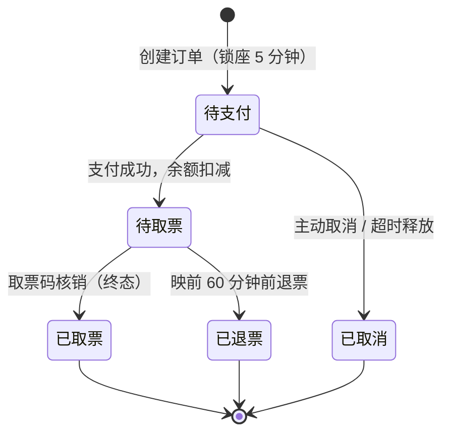
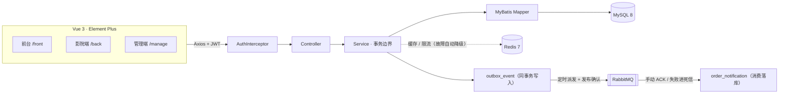

<div align="center">
  <h1>CineBook</h1>
  
  <p>
    <a href="https://github.com/renjianfeng8/cinebook/actions/workflows/ci.yml"></a>
    
    
    
    
    
  </p>
  <p>
    <a href="#快速开始">快速开始</a> ·
    <a href="#功能一览">功能一览</a> ·
    <a href="#技术栈">技术栈</a> ·
    <a href="#质量保障">质量保障</a> ·
    <a href="项目索引.md">项目文档</a>
  </p>
</div>

## 项目简介

一个**前后端分离、三端协同**的电影购票平台：游客和用户在前台选片购票，影院在后台维护影厅与排片，平台管理员负责账号、影院审核、影片资料与资金流水。

项目不是 CRUD 演示：下单锁座、余额支付、取票码核销、退票回滚都在真实事务里完成，并针对**并发抢座、排片重叠、删除与下单竞争、改影厅与下单竞争**做了锁与冲突处理。后端 588 条测试、前端 37 条单测、5 条 Playwright 冒烟，CI 全绿。

**高并发票务改造**：座位级库存表 `screening_seat` 用条件更新原子锁座；`request_id` 双闸幂等；Redis Lua 原子限流与版本号缓存；Outbox 事件表 + RabbitMQ（发布确认、手动 ACK、消费幂等、死信队列）保证「支付/取消/退票」事件不丢不重。

## 功能一览

| 前台（游客 / USER） | 影院端（CINEMA） | 管理端（ADMIN） |
| --- | --- | --- |
| 首页轮播、今日票房、热播 / 待映、票房与口碑榜 | 影厅管理 | 数据驾驶舱 |
| 影片筛选、详情、演职人员、影评与点赞 | 排片管理（防同厅时段重叠） | 账号管理、影院审核 |
| 影院列表、城市 / 区域筛选、按片选场 | 订单出票与取票核销 | 影片（TMDB 导入）、演员、类型、地区 |
| 可视化选座、余额支付、取票码 | 公告、个人资料、改密 | 影厅、排片、订单取消 / 退票 |
| 订单全流程：续付 / 取消 / 退票 / 取票 / 评价 | | 评价、充值审核、资金流水 |
| 账户充值、流水、余额走势、支付密码 | | 公告、预告片、影院名录（高德导入） |

**购票主链**：选片 → 选影院 → 选场次 → 选座 → 建单锁座 → 余额 + 支付密码支付 → 生成取票码 → 取票大厅核销。



## 技术栈

| 层 | 选型 |
| --- | --- |
| 后端 | Spring Boot 3.3.13 · Java 17 · MyBatis（XML Mapper）· PageHelper · jjwt · BCrypt |
| 数据库 | MySQL 8.0 · 22 张业务表 · 订单状态库级 `CHECK` |
| 基础设施 | Redis 7（热点缓存、Lua 原子限流）· RabbitMQ（Outbox 事件、死信队列） |
| 前端 | Vue 3.5 · Vue Router 4.5 · Element Plus 2.9 · ECharts 6 · Vite 6 · Sass |
| 测试 | JUnit 5 + Mockito（后端）· Vitest（前端）· Playwright（E2E） |
| 工程 | GitHub Actions CI · ESLint · 统一响应 `Result<T>` · JWT + RBAC |

**分层**：`Controller 23 → Service 34 → Mapper 21 → MySQL`。通用 CRUD 由 `BaseController / BaseService / BaseMapper` 收敛，业务规则在 Service 覆写；HTTP 边界只进出 DTO，实体不出 Controller。



**下单数据流**：`POST /api/v1/orders` → 限流（Redis Lua）→ `request_id` 查重 → `UPDATE screening_seat ... WHERE status=0` 原子锁座（受影响行数必须等于座位数）→ 订单落库（`UNIQUE(user_id, request_id)` 兜底并发重复）。支付/取消/退票在同一个事务里写 `outbox_event`，提交后由派发任务投递 RabbitMQ，消费端写通知并逐条 ACK。

## 快速开始

### 环境要求

- JDK 17+、Maven 3.9+
- Node.js 20+（CI 使用 22）
- MySQL 8.0，开发库 `xm-film`，测试库 `xm_film_test`
- Redis 7（可选，缺失时缓存/限流自动降级）
- RabbitMQ 3（可选，`ORDER_EVENT_PUBLISHER=rabbit` 时才需要）

### 0. 一键启动依赖（可选）

```bash
docker compose up -d       # MySQL 3306 · Redis 6379 · RabbitMQ 5672 / 15672
docker compose ps          # 三个容器全部 healthy 后再往下走
```

没有 Docker 也可以只装 MySQL：Redis / RabbitMQ 缺省时后端仍可启动运行。

### 1. 初始化数据库

```bash
mysql -uroot -p -e "CREATE DATABASE \`xm-film\` DEFAULT CHARACTER SET utf8mb4 COLLATE utf8mb4_unicode_ci"
mysql -uroot -p xm-film < xm_film/springboot/src/test/resources/db/schema.sql
mysql -uroot -p xm-film < xm_film/springboot/src/test/resources/db/token_revocation.sql
```

**存量库升级按版本号顺序执行迁移脚本**（可重复执行，脚本内带 `IF NOT EXISTS` / `information_schema` 守卫）：

```bash
mysql -uroot -p xm-film < xm_film/springboot/src/main/resources/db/migration/V1__init_seat_inventory.sql   # 座位库存/Outbox/消费日志 3 张表 + ordered.request_id
mysql -uroot -p xm-film < xm_film/springboot/src/main/resources/db/migration/V2__backfill_seat_inventory.sql # 生成座位行并同步仍有效订单的占用（含冲突预检）
mysql -uroot -p xm-film < xm_film/springboot/src/main/resources/db/migration/V3__order_notification.sql     # 消费侧通知表（事件幂等）
mysql -uroot -p xm-film < xm_film/springboot/src/main/resources/db/migration/V4__outbox_multi_instance_claim.sql # Outbox 多实例认领字段与索引
```

> `schema.sql` 是**只读结构快照**，每条建表语句前都有 `DROP TABLE`，不要把本文件对着有数据的库执行。
> 仓库只带表结构与演示业务数据 `demo-data.sql`；影片、影院等基础种子数据需按 [`db/README.md`](xm_film/springboot/src/test/resources/db/README.md) 的口径准备后，再执行 `mysql -uroot -p xm-film < xm_film/springboot/demo-data.sql` 重置演示数据。
>
> **顺序要求**：`demo-data.sql` 直接插入排片、不会生成座位行，执行完必须再跑一次 `V2__backfill_seat_inventory.sql`；否则演示场次在选座图里没有座位、无法下单。`V1` / `V3` 建的表已包含在 `schema.sql` 中，新库可跳过（跑也无副作用）。
>
> `V2` 只回填**仍有效**的订单（未超时的待支付 → 锁定，待取票/已取票 → 售出），已取消/已退票的订单不会参与，也不会反向清空别人已买的座位；若同一座位存在多个有效订单会直接中止迁移，需先人工清理冲突数据。

### 2. 启动后端（9090）

```bash
cd xm_film/springboot
cp .env.example .env          # Windows: Copy-Item .env.example .env
# 填写 JWT_SIGNING_KEY（至少 32 字节）与 DB_PASSWORD
mvn spring-boot:run
```

缺少 `JWT_SIGNING_KEY` 时后端会拒绝启动，这是刻意设计：仓库不保存任何密钥。

常用环境变量（`springboot/.env`，或直接设为进程环境变量）：

| 变量 | 默认值 | 说明 |
| --- | --- | --- |
| `JWT_SIGNING_KEY` | 无（必填） | JWT 签名密钥，至少 32 字节 |
| `DB_USERNAME` / `DB_PASSWORD` | `root` / 空 | MySQL 账号 |
| `REDIS_HOST` / `REDIS_PORT` / `REDIS_PASSWORD` | `localhost` / `6379` / 空 | Redis 连接；服务不可用时缓存与限流自动降级 |
| `ORDER_EVENT_PUBLISHER` | `local` | `local` 进程内直派（无需 MQ）；`rabbit` 走真实 RabbitMQ |
| `RABBITMQ_HOST` / `RABBITMQ_PORT` | `localhost` / `5672` | RabbitMQ 连接 |
| `RABBITMQ_USERNAME` / `RABBITMQ_PASSWORD` | `guest` / `guest` | RabbitMQ 账号 |
| `OUTBOX_DISPATCH_INTERVAL_MS` | `3000` | Outbox 派发轮询间隔 |
| `SEAT_CLEANUP_INTERVAL_MS` | `60000` | 过期座位锁补偿间隔 |
| `AMAP_KEY` | 空 | 后台「从高德导入影院」使用 |

> 切换 `ORDER_EVENT_PUBLISHER=rabbit` 前先启动 RabbitMQ；拓扑（交换机/队列/死信）由应用启动时自动声明，
> 管理控制台 <http://localhost:15672>（guest/guest）可以看到 `cinebook.order.queue` 与 `cinebook.order.dlq`。

### 3. 启动前端（5173）

```bash
cd xm_film/vue
npm install
npm run dev
```

打开 <http://localhost:5173>。

### 4. 演示账号

| 角色 | 账号 | 密码 |
| --- | --- | --- |
| 前台用户 | `u1` | `u1` |
| 管理员 | `999` | `999` |

所有演示用户的**支付密码均为 `123456`**。影院端账号与完整演示剧本见 [`docs/demo-script.md`](docs/demo-script.md)。

## 目录结构

```
cinebook/
├── xm_film/
│   ├── springboot/            # Spring Boot 后端
│   │   ├── src/main/java/     # controller / service / mapper / entity / dto
│   │   ├── src/main/resources/mapper/
│   │   ├── src/test/          # 82 个测试源文件，含数据库结构快照
│   │   └── demo-data.sql      # 演示业务数据
│   └── vue/                   # Vue 3 前端
│       ├── src/views/         # front / back / manage 三端页面
│       ├── src/components/    # 海报卡、支付弹窗、密码输入等
│       └── e2e/               # Playwright 冒烟
├── docs/                      # 架构、业务域、前后端、演示剧本
├── audit/                     # 技术债与审计记录
└── 项目索引.md                # 文档唯一入口
```

## 质量保障

| 项 | 现状 |
| --- | --- |
| 后端测试 | 82 个测试文件 / **580 条**（`mvn test`） |
| 前端单测 | 6 个测试文件 / **37 条**（`npm test`） |
| 浏览器冒烟 | **5 条** Playwright（`npm run test:e2e`） |
| CI | 后端测试 + 前端 lint / 单测 / 构建 |
| 并发 | 抢座、建排片、删排片 vs 下单均有实测；冲突映射 409 可重试 |
| 库存与事件 | 并发锁同一座位仅 1 个成功、事务回滚释放座位、重复请求返回原订单、Outbox 指数退避与死信、Redis 故障降级均有单测/集成测试 |
| 安全 | JWT 吊销、BCrypt、登录失败锁定、充值审核限 ADMIN、密钥走 `.env` |

## 文档

| 文档 | 内容 |
| --- | --- |
| [项目索引](项目索引.md) | 文档地图、一页纸事实、易踩清单 |
| [架构](docs/architecture.md) | 技术栈、分层、鉴权、统一响应与异常 |
| [业务域](docs/domain.md) | 订单状态机、资金账本、支付密码、排片 |
| [前端](docs/frontend.md) | 路由、composables、样式令牌、页面清单 |
| [后端](docs/backend.md) | 控制器、鉴权前缀表、Base 三件套、DTO |
| [演示剧本](docs/demo-script.md) | 演示账号、数据规模、操作顺序 |

## License

[MIT](LICENSE) © 2026 renjianfeng8
